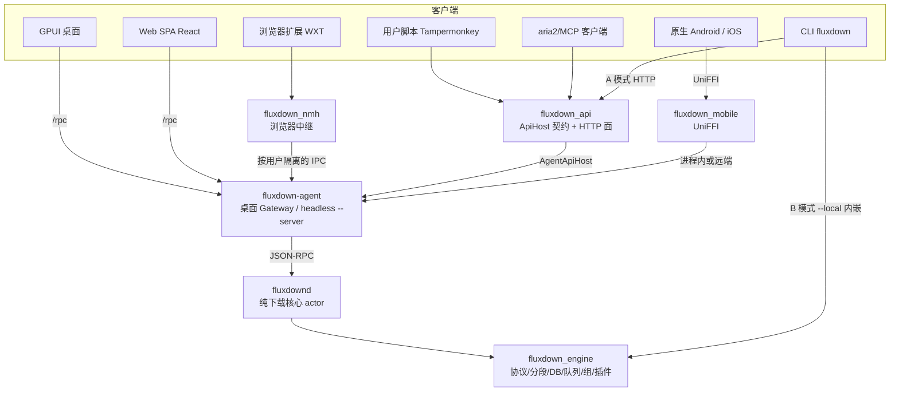
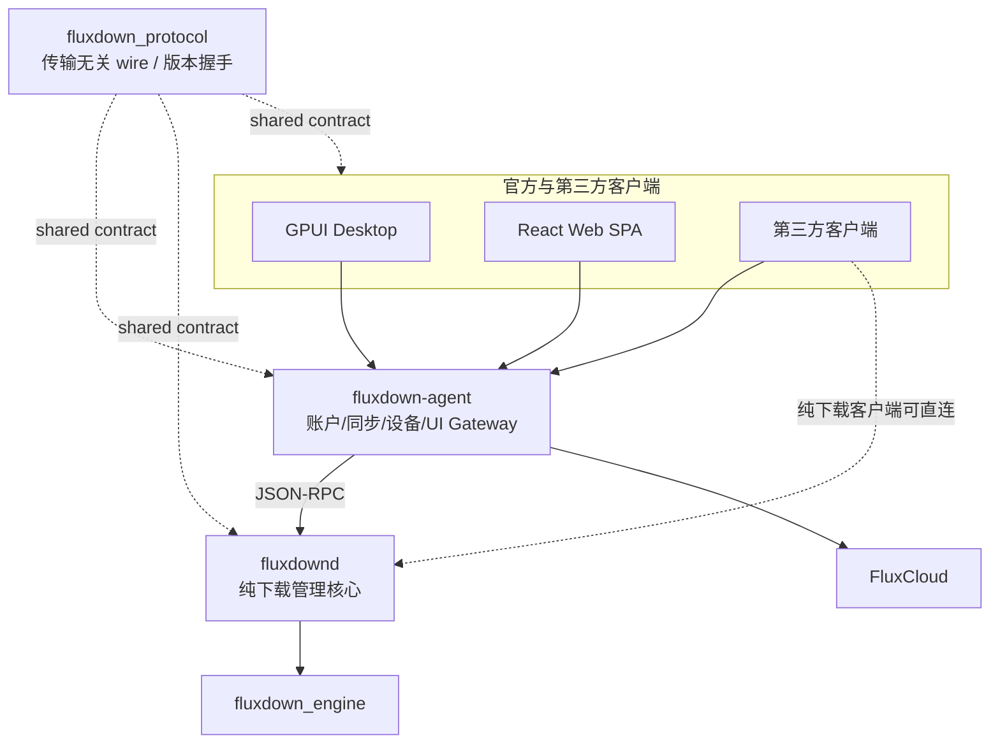

# FluxDown internals · 索引 · 架构图 · 目录树

> 本文件是 `FluxDown/AGENTS.md` 的深挖附录：只放**枚举性 / 可从源码复原**的细节，硬不变式与红线在 AGENTS.md。
> 路径以 `FluxDown/` 为根（cwd=工作区根时前置 `FluxDown/`）。事实层以源码为准，文档给坐标。

---

## 产品定位

> **"Downloads, Supercharged."**（下载，全面加速。）

- **核心价值主张**: Rust 驱动的高速多协议下载，永久免费，零广告，零追踪（仅两条匿名部署遥测，可关），本地优先，无需账号即可全功能使用。
- **平台矩阵**: Windows / macOS / Linux 桌面 = **GPUI**；Android = `mobile/Android`（Kotlin / Compose），iOS = `mobile/FluxDown`（SwiftUI），两端经 `native/mobile` 连接共享核心；headless = `fluxdown-agent --server` + `fluxdownd`（Docker/群晖/QNAP/OpenWrt/Unraid/CasaOS）；另有 CLI（`fluxdown`）、浏览器扩展、用户脚本。
- **可选云能力（FluxCloud）**: 登录账号后跨设备**配置同步**由 agent 承担，各客户端通过 agent 使用（见 `clients.md`）；下载本身永远本地，账号非必需。
- **版本来源**: Rust 发行物按 release tag 注入 `FLUXDOWN_APP_VERSION`，服务/GPUI 读 `fluxdown_protocol::APP_VERSION`；protocol 与引擎本地均回退 `CARGO_PKG_VERSION`，GPUI macOS 打包默认从 `cargo metadata` 的 `fluxdown_ui_app.version` 取值。详见 `ops.md`。

---

## 附录索引

| 文件 | 内容 |
|---|---|
| `README.md`（本文件） | 架构全图、顶层目录树 |
| `engine.md` | 状态与数据模型、DB 表与字段语义、6 协议、引擎子系统、插件系统、受管组件 |
| `hosts-and-api.md` | HTTP API 路由组与鉴权、agent / cli / nmh / updater、headless server env 与路由 |
| `clients.md` | GPUI 桌面、原生 Android/iOS、旧数据与主题兼容、扩展、用户脚本、Web SPA、官网 |
| `ops.md` | 日志系统、发布与 CI、设计文档实现状态 |
| `extension-points.md` | 「要加 X 改哪里」全表 |
| `pitfalls.md` | 踩坑清单：按领域分节的已验证约束（现象 + 代码坐标 / 回归测试）；改某领域前先读对应小节 |
| [torrent-preview.md](torrent-preview.md) | 种子 / 磁力链打开确认的当前行为、入口覆盖、实现边界与回归测试 |

---

## 顶层架构

**一个引擎，多个宿主，多个客户端。** 所有下载逻辑集中在 `fluxdown_engine`（`native/engine`，零 UI/FFI 依赖），经引擎的 `EventSink` / `HostSelection` 与 API 层的 `ApiHost` 解耦：

| Trait | 定义位置 | 方向 | 职责 |
|---|---|---|---|
| `EventSink` | `engine/src/events.rs` | 引擎→宿主 | 进度/分段拆分/队列变化/组变化等事件推送 |
| `HostSelection` | `engine/src/selection.rs` | 引擎→宿主（请求决策） | HLS 画质 / BT 文件 / 插件 variant 选择 / 「文件已存在」询问（tristate：用户选/超时默认/无 selector 短路；`can_prompt()` 决定是否为询问让槽挂起） |
| `ApiHost` | `native/api/src/service.rs` | 客户端→引擎（HTTP 契约） | REST/aria2/MCP 的能力面；必需方法 + 可默认降级方法 |



**要点**：
- `fluxdown_api` 只依赖 `&dyn ApiHost`，不碰引擎——同一套 HTTP 面（脚本接管 + aria2 JSON-RPC（POST 与 WS）+ MCP + `/api/v1` 管理 + OpenAPI）可服务任意宿主。
- 生产链路：GPUI 桌面与 headless 共用 agent + daemon（`AgentApiHost` 将 HTTP 操作转发给 daemon；daemon 的 `actor.rs` 独占引擎）；原生 Android/iOS 经 `native/mobile` 复用进程内 agent + daemon 或远端 `/rpc`。持有引擎的 actor **必须** drain `resolve_rx`（off-actor 插件解析回流）与 `plugin_retry_rx`，否则命中 resolver 的下载会永久挂起。
- 客户端捕获汇入 agent 的同一捕获/确认队列：扩展经 NMH IPC，用户脚本经 `:17800/download`，桌面经 `/rpc` 提交；不是所有前端都经过 HTTP `/download`。
- **并发模型**: current_thread tokio actor 串行化写；每个下载 spawn 独立 task + CancellationToken；插件 resolve 永不阻塞 actor（off-actor spawn + 通道回流）。

### 桌面与 headless 本机服务边界（已用于发行链路）



- `native/daemon` 是 aria2c 式纯下载核心：下载任务、下载设置、RSS、插件和下载事件归它；账户与云同步永不进入该边界。
- `native/agent` 是可选但常驻的官方客户端后端：独占 FluxCloud Token、配置同步、设备协同和远程任务状态机；官方 UI 默认只连接 agent。
- `native/protocol` 是 daemon、agent 与 GPUI / React Web SPA 等客户端共享的 wire 层，服务角色、握手、JSON-RPC 方法/事件与 DTO 都以实际协议目录为准，不为 UI 建立第二套 DTO。
- `native/link`（`fluxdown_link`）是局域网直连（L1）协议本体：身份、配对（SAS）、mDNS 发现、直连传输、地址解析（`http(s)://host[:port][/base]`），持久化经 `LinkStorage` trait 注入，agent 使用自身状态文件。不依赖引擎、数据库或 UI。
- 当前发行路径：PC = GPUI → agent + daemon，headless / NAS 同用 agent + daemon；原生移动端经 `native/mobile` 复用同一服务边界。Android 正式发布用 `ANDROID_NATIVE_*` 签名，不能覆盖旧 Flutter APK；共享 assets 与当前客户端的旧数据/主题兼容保留。

---

## 仓库结构（顶层坐标）

```
FluxDown/
├── mobile/
│   ├── Android/       Kotlin / Compose 原生 Android（Flux Lumen）
│   └── FluxDown/      SwiftUI 原生 iOS（Liquid Glass）与 FluxKit
├── assets/             GPUI / Web / 原生移动端共享资源（不随旧 Flutter 工程删除）
├── crates/             已发布 GPUI PC 客户端（同一 Rust workspace，见 `clients.md`「GPUI PC 客户端」）
│   ├── i18n/           构建期发现并嵌入共享 `assets/i18n/*.json`
│   ├── theme/          完整 gpui-base semantic token + shadcn neutral + 运行时投影
│   ├── components/     基于 gpui-base 行为原语的主题化应用组件
│   ├── shell/          窗口、顶层导航、locale/theme 状态
│   └── app/            `fluxdown-desktop` 薄二进制入口
├── native/             Rust workspace 引擎/宿主层（根 members=`native/*` + `crates/*`）
│   ├── engine/         `fluxdown_engine`：下载引擎（零 FFI）——核心，见 `engine.md`「下载引擎」
│   ├── api/            `fluxdown_api`：ApiHost 契约 + HTTP 面（零引擎依赖）——见 `hosts-and-api.md`「HTTP API」
│   ├── protocol/       `fluxdown_protocol`：daemon / agent / 客户端共享的传输无关协议基线
│   ├── daemon/         `fluxdown_daemon`：桌面/headless 的纯下载常驻核心
│   ├── agent/          `fluxdown_agent`：桌面/headless 的云功能与官方 UI Gateway
│   ├── link/           `fluxdown_link`：局域网直连 L1 协议（配对 / mDNS / 直连传输），由 agent 承载
│   ├── mobile/         `fluxdown_mobile`：原生移动端 UniFFI 核心（进程内 daemon + agent 嵌入 / 远端 `/rpc`）——见 `clients.md`「原生移动端」
│   ├── cli/            `fluxdown_cli`：二进制 `fluxdown`——见 `hosts-and-api.md`「宿主与客户端 crate」
│   └── nmh/            Native Messaging Host 中继二进制
├── web/                Web SPA（React 19 + TanStack + Tailwind v4，bun）——见 `clients.md`「Web SPA」
├── website-v2/         官网（Astro SSR + 内容集文档系统，根路径部署）——见 `clients.md`「官网」
├── fluxDown/           WXT 浏览器扩展（Chrome/Firefox MV3）——见 `clients.md`「浏览器扩展与用户脚本」
├── userscript/         Tampermonkey 用户脚本（扩展替代）——见 `clients.md`「浏览器扩展与用户脚本」
├── examples/plugins/   插件示例（.fxplug 源）
├── packaging/          NAS 包脚本（synology/qnap/openwrt/fnos）——见 `hosts-and-api.md`「Headless 服务器」
├── promotion/          分发模板（unraid/casaos/awesome-selfhosted/mcp）
├── docker/             server.Dockerfile + docker-compose.yml
├── installer/windows/  Inno Setup
├── bucket/             Scoop manifest
├── docs/               设计文档（实现状态见 `ops.md`「设计文档实现状态」）
└── .github/workflows/   ci.yml 主干门禁 + release.yml 组件发布——见 `ops.md`「发布与 CI」
```
