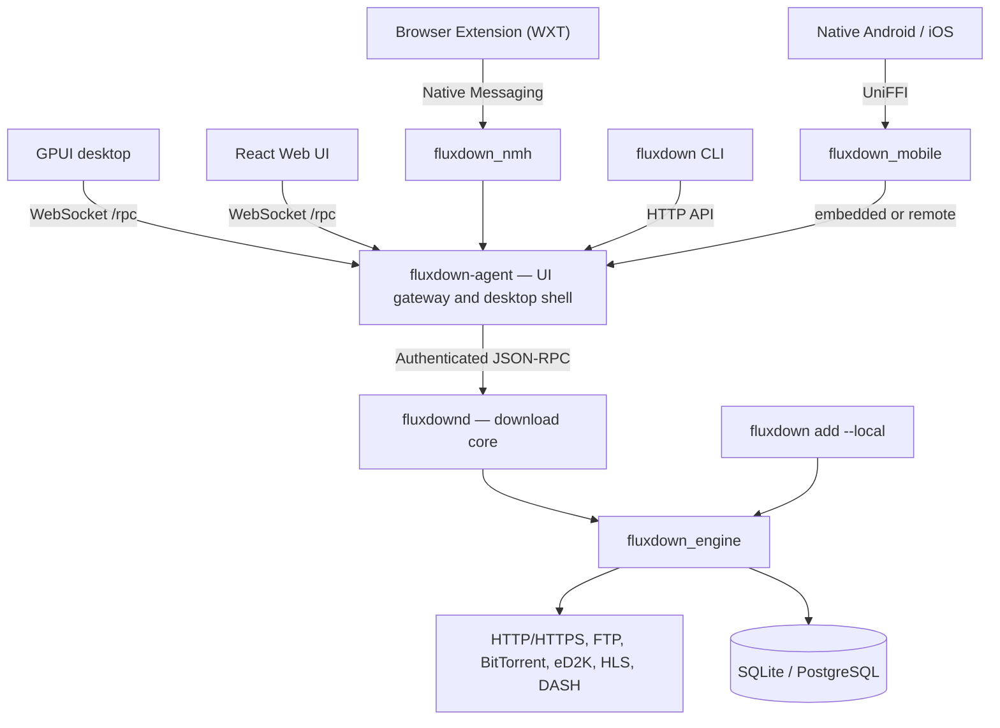

<div align="center">


# FluxDown

### ダウンロードを、もっと速く。

*非常に高速なマルチプロトコル対応のダウンロードマネージャー。無料でオープンソースの IDM の代替です。*

[](https://github.com/zerx-lab/FluxDown/releases/latest)
[](https://github.com/zerx-lab/FluxDown/releases)
[](LICENSE)
[](#インストール)
[](native/engine)
[](crates/app)
[](mobile)
[](https://glama.ai/mcp/servers/zerx-lab/FluxDown)

[](https://github.com/rust-unofficial/awesome-rust#utilities)
[](https://github.com/thechampagne/awesome-windows#utilities)
[](https://github.com/Axorax/awesome-free-apps#download-managers)
[](https://github.com/offa/android-foss#-downloader--manager)
[](https://github.com/pcqpcq/open-source-android-apps/blob/master/categories/tools.md)
[](https://portainer-templates.as93.net/fluxdown)
[](https://github.com/selfhosters/unRAID-CA-templates/blob/master/templates/fluxdown.xml)
[](https://github.com/1c7/chinese-independent-developer)

[**Web サイト**](https://fluxdown.com) · [**ダウンロード**](https://fluxdown.com/#download) · [**変更履歴**](https://fluxdown.com/changelog) · [**FAQ**](https://fluxdown.com/faq) · [**フィードバック**](https://fluxdown.com/feedback)

[English](README.md) | [简体中文](README.zh-CN.md) | **日本語**

</div>

---

## ハイライト

- **動的なダウンロードの高速化** — 適応的な分割と遅いセグメントの救済を備えた Rust + Tokio のエンジン
- **マルチプロトコル** — HTTP/HTTPS、FTP、BitTorrent、eD2K、HLS と DASH のストリーミング
- **1 つのエンジンで複数のクライアント** — ネイティブの GPUI デスクトップ、Kotlin の Android アプリと SwiftUI の iOS アプリ、React の Web UI と CLI
- **ブラウザとの統合** — 3 層の横取りエンジンを備えた Chrome / Edge / Firefox の拡張機能と、ユーザースクリプト
- **AI エージェントに対応** — MCP（Model Context Protocol）サーバーを内蔵：Claude、Cursor などの AI クライアントにダウンロードを管理させられます
- **自動化とリモート管理** — RSS の購読、スケジュールされたキュー、Webhook、プラグイン、オプションの FluxCloud によるデバイス間の連携
- **ローカルファースト** — 無料でオープンソース、広告なし、ローカルのダウンロードにアカウントは不要です。再開用の状態はデフォルトでローカルに保存されます

## 機能

| 機能 | 説明 |
|---|---|
| **Rust によるエンジン** | UI と FFI から独立した共通の Rust + Tokio のエンジンで、デスクトップ、モバイル、サーバー、単独の CLI のホストで使われます |
| **スマートな分割** | セグメントは実行時に動的に分割され、手の空いたワーカーが遅いセグメントを引き継ぎます |
| **マルチプロトコル** | HTTP/HTTPS、FTP、BitTorrent（DHT/UPnP/マグネット）、eD2K（サーバーと Kad DHT によるソースの検索、MD4 による検証）、HLS（AES の復号）、DASH 向けの専用のエンジン |
| **キューと速度の制御** | 名前付きのキュー、スケジュール、トークンバケット方式による全体の速度制限 |
| **永続化と再開** | デフォルトは WAL モードの SQLite で、サーバーのデプロイでは PostgreSQL も使えます。永続化された状態からダウンロードを復旧します |
| **ブラウザとの統合** | ダウンロードの横取り、ストリーミングメディアの検出、Alt+クリックによるバイパス、右クリックでの送信、接続の診断 |
| **デスクトップと Web の UI** | GPUI のデスクトップと React の Web の管理画面、ライト/ダークのテーマ、カスタムテーマ、タスクの詳細とセグメントの可視化。デスクトップのトレイによって、UI を閉じたあともサービスを利用できます |
| **RSS と自動化** | フィードのフィルター、無人のダウンロード、JavaScript のプラグイン、管理された FFmpeg/yt-dlp のコンポーネント、タスクのイベントの Webhook |
| **リモートのデバイス** | オプションの FluxCloud のアカウント、設定の同期とリモートでのタスク管理、LAN でのデバイスのペアリングと直接の接続 |
| **API と CLI** | REST/OpenAPI、aria2 互換の JSON-RPC、12 のツールを備えた MCP、スクリプトや単独のダウンロードのための CLI |

**プライバシー：** ローカルのダウンロードに FluxCloud のアカウントは必要ありません。クラウドの機能はオプションです。匿名のインストール数と日次アクティブの統計は `analytics_enabled` で制御され、無効にできます。ダウンロードやタスクの情報は収集しません。テレメトリーがまったくないアプリケーションではありません。

## FluxDown と IDM の比較

| | FluxDown | IDM |
|---|:---:|:---:|
| 価格 | **無料でオープンソース** | $24.95 + 更新料 |
| オープンソース | はい（AGPL-3.0） | いいえ |
| プラットフォーム | Windows / macOS / Linux / NAS / Android | Windows のみ |
| BitTorrent とマグネット | はい | いいえ |
| eD2K / eMule のリンク | はい | いいえ |
| HLS / DASH のストリーミング | はい | 一部 |
| 動的な分割 | はい | はい |
| ブラウザの拡張機能 | Chrome / Edge / Firefox | はい |
| 広告 | **なし** | — |

## インストール

最新のビルドを [**GitHub Releases**](https://github.com/zerx-lab/FluxDown/releases/latest) または [**fluxdown.com**](https://fluxdown.com/#download) から入手してください：

| プラットフォーム | パッケージ |
|---|---|
| **Windows**（x64 / ARM64） | `setup.exe` インストーラー · ポータブル版 `.zip` |
| **macOS**（Intel / Apple Silicon） | `.dmg` · ポータブル版 `.tar.gz` |
| **Linux**（x64） | `.AppImage` · `.deb` · Arch `.pkg.tar.zst` · ポータブル版 `.tar.gz` |
| **Android**（arm64-v8a / armeabi-v7a / x86_64） | ABI ごとの `.apk` · ユニバーサル `.apk` |
| **NAS / サーバー**（ヘッドレス、x64 / ARM64） | [Docker](https://ghcr.io/zerx-lab/fluxdown-server) · Synology DSM 6/7 `.spk` · QNAP `.qpkg` · OpenWrt `.apk`（25.12 以降）/ `.ipk` · Unraid CA のテンプレート · CasaOS / ZimaOS のアプリストア |

### ブラウザの拡張機能

拡張機能をインストールすると、FluxDown がブラウザのダウンロードを自動的に引き継ぎます：

[](https://chromewebstore.google.com/detail/fluxdown/meleenglfggcmcajknpeeeiobnpfmahc)
[](https://microsoftedge.microsoft.com/addons/detail/fluxdown/nglkkjbogjghekbhhcnccnpfedjbdhhd)
[](https://addons.mozilla.org/firefox/addon/fluxdown)

拡張機能は、Native Messaging を通じてデスクトップのエージェントに接続します。[Tampermonkey のユーザースクリプト](userscript/)も利用できます。

### NAS / サーバー

現在のヘッドレスのサービスは **`fluxdown-agent --server` + `fluxdownd`** で、Web UI が組み込まれています。Docker イメージの名前は `ghcr.io/zerx-lab/fluxdown-server` のままです。

チェックアウトから、付属の [Compose の設定](docker/docker-compose.yml)を使います：

```shell
docker compose -f docker/docker-compose.yml up -d
```

`http://<server>:17800/` を開き、初回起動時のウィザードでアクセスキーを設定します。キーは 8〜128 文字の表示可能な ASCII 文字で、英字と数字の両方を含む必要があります。サービスを公開する前に、信頼できるネットワーク上で設定してください。リモートからアクセスする場合は、HTTPS のリバースプロキシを使ってください。

- サーバーモードは、デフォルトで `[::]:17800`（IPv4 + IPv6。IPv6 がない場合は `0.0.0.0` にフォールバック）で待ち受けます。`FLUXDOWN_BIND` で上書きできます。
- 無人でセットアップする場合は、コミットするファイルではなく、デプロイの環境変数やシークレットマネージャーを通じて `FLUXDOWN_TOKEN` を渡してください。キーがまだ設定されていない場合にのみ、キーを初期化します。
- データベース、ログ、アクセスキーのために `/data` を、ダウンロードのために `/root/Downloads` を永続化してください。付属の Compose ファイルは、名前付きのデータボリュームと、ホストの `docker/downloads/` を使います。
- ダウンロード用のディスクをスリープさせる必要がある場合は、`/data` には SSD/キャッシュのストレージを使うことをおすすめします。
- ネイティブのデプロイでは、`fluxdown-agent` と `fluxdownd` を同じディレクトリに置く必要があります。

## CLI と HTTP API

`fluxdown` の CLI は、デフォルトで、実行中のデスクトップまたはサーバーの HTTP API に接続します。デスクトップでは、まず Settings → API Service で管理 API を有効にしてください。アクセスキーは `FLUXDOWN_TOKEN` で渡します。リモートのサーバーを選ぶには、`FLUXDOWN_URL` または `--url` を使います。

```shell
fluxdown ping
fluxdown add "https://example.com/file.zip"
fluxdown --json list

# Standalone mode: embed the engine instead of connecting to a service
fluxdown add --local "https://example.com/file.zip"
```

単独モードは、実行中のエンジンとデータディレクトリを共有できません：先に、そのディレクトリを使っているサービスを停止してください。

| インターフェース | エンドポイント | 用途 |
|---|---|---|
| REST の管理 API | `/api/v1/*` | タスク、キュー、RSS などの管理操作 |
| OpenAPI | `/api/v1/openapi.json` | 機械可読な API のスキーマ |
| aria2 互換の JSON-RPC | `/jsonrpc`（HTTP / WebSocket） | aria2 互換のクライアントとの統合 |
| MCP | `/mcp` | AI エージェントのためのツール |
| 公式の UI のプロトコル | `/rpc`（WebSocket） | GPUI/Web のゲートウェイ。aria2 の API とは別のものです |

デスクトップのデフォルトは `127.0.0.1:17800` で、管理 API と MCP は有効にするまで無効になっています。サーバーモードではどちらもデフォルトで有効で、アクセスキーが必要です。REST の契約については [OpenAPI の仕様](website-v2/public/openapi.json)をご覧ください。

## MCP サーバー（Model Context Protocol）

FluxDown は **MCP サーバー** を内蔵しているので、AI エージェント（Claude Desktop、Cursor、Cline など）が [Model Context Protocol](https://modelcontextprotocol.io) を通じてダウンロードを管理できます。同じ API のポート上で、ステートレスな **Streamable HTTP** のサブセット（`POST /mcp` 上の JSON-RPC 2.0）を実装しており、別の MCP のプロセスは必要ありません。

- **エンドポイント**：デフォルトのデスクトップの設定では `http://127.0.0.1:17800/mcp`。ヘッドレスのデプロイでは、サーバーのアドレスを使います
- **認証**：Bearer トークン（`Authorization: Bearer <token>` または `X-FluxDown-Token`）。管理 API と共通です
- **有効化**：Settings → API Service → *MCP endpoint* をオンにします（トークンは自動で生成されます）。ヘッドレスのサーバーではデフォルトで有効です

### ツール（12）

| ツール | 説明 |
|---|---|
| `download_add` | ダウンロードのタスクを作成します（HTTP/HTTPS、FTP、マグネット、BitTorrent） |
| `download_list` | 進捗/速度/状態とともにタスクを一覧表示します。状態での絞り込みも可能です |
| `download_get` | ID で 1 つのタスクを取得します |
| `download_pause` / `download_resume` | 1 つのタスクを一時停止 / 再開します |
| `download_pause_all` / `download_resume_all` | すべてのタスクを一時停止 / 再開します |
| `download_remove` | タスクを削除します。ダウンロードしたファイルを削除することもできます |
| `queue_list` | 名前付きのキューとその設定を一覧表示します |
| `rss_list` | RSS の購読を、その設定と実行時の状態とともに一覧表示します |
| `rss_add` | RSS フィードを購読し、スケジュールに従ってポーリングを開始します |
| `rss_remove` | RSS の購読と、それが集めた項目を削除します |

### クライアントの設定

```json
{
  "mcpServers": {
    "fluxdown": {
      "url": "http://127.0.0.1:17800/mcp",
      "headers": { "Authorization": "Bearer <your-token>" }
    }
  }
}
```

MCP のレイヤーは、REST の管理 API と aria2 互換の JSON-RPC を支えているのと同じ `ApiHost` トレイトの上に、[`native/api/src/mcp.rs`](native/api/src/mcp.rs) で実装されています。

## アーキテクチャ

**1 つの Rust のダウンロードエンジンと、複数のホストとクライアント。** デスクトップは `fluxdown-desktop → fluxdown-agent → fluxdownd` を使い、ヘッドレスのデプロイでは、エージェントとデーモンを React の Web UI とともに再利用します。ネイティブの Android と iOS のクライアントは UniFFI（`native/mobile`）を通じて接続し、ローカルのダウンロードには組み込みのエージェントとデーモンを、リモートのホストには `/rpc` を使います。



- **ダウンロードはデーモンが担当：** エンジン、ダウンロードのデータベース、キュー、RSS、プラグイン、Webhook。
- **統合はエージェントが担当：** UI のゲートウェイ、FluxCloud のアカウント/同期、デバイス間の連携、ブラウザからの取得、デスクトップのトレイ/ライフサイクル。
- **共通の契約：** `native/protocol` は、トランスポートに依存しない DTO、メソッド、イベントを定義します。`native/api` は、エンジンに依存せずに、`ApiHost` を通じて REST、aria2、MCP を公開します。
- **エンジンの独立性：** `EventSink` と `HostSelection` がエンジンとホストをつなぎます。1 つのデータディレクトリに書き込めるエンジンは、一度に 1 つだけです。図は代替となるホストを示しており、同時に書き込むものではありません。

| レイヤー | 技術 | パス |
|---|---|---|
| デスクトップの UI | Rust + GPUI。アプリの構成と機能ごとのクレート | [`crates/`](crates), [`crates/app/`](crates/app) |
| エージェント / デーモン | UI のゲートウェイとヘッドレスのホスト / ダウンロードのコア | [`native/agent/`](native/agent), [`native/daemon/`](native/daemon) |
| 共通のプロトコル / HTTP API | JSON-RPC の DTO / REST、aria2、MCP のアダプター | [`native/protocol/`](native/protocol), [`native/api/`](native/api) |
| ダウンロードのエンジン | Rust + Tokio。UI や FFI への依存なし | [`native/engine/`](native/engine) |
| モバイルの UI / ブリッジ | Kotlin + Jetpack Compose / SwiftUI + UniFFI | [`mobile/Android/`](mobile/Android), [`mobile/FluxDown/`](mobile/FluxDown), [`native/mobile/`](native/mobile) |
| Web の管理画面 | React + TypeScript + Vite | [`web/`](web) |
| CLI | HTTP のクライアントまたは組み込みのエンジン | [`native/cli/`](native/cli) |
| ブラウザとの統合 | WXT + TypeScript、Native Messaging、ユーザースクリプト | [`fluxDown/`](fluxDown), [`native/nmh/`](native/nmh), [`userscript/`](userscript) |
| Web サイト | Astro + React | [`website-v2/`](website-v2) |

## ソースからのビルド

まず、[Rust のツールチェーン](https://www.rust-lang.org/tools/install)と、お使いのプラットフォームのネイティブのビルドツール（Windows では MSVC、macOS では Xcode のコマンドラインツール）を用意してください。Linux のデスクトップのビルドには、グラフィックス、オーディオ、トレイの開発用ライブラリも必要です。メンテナンスされている Ubuntu のパッケージの一覧は [CI](.github/workflows/ci.yml) にあります。Web UI には [Bun](https://bun.sh) が必要です。Android では Android Studio の JBR、Android SDK/NDK、`cargo-ndk` を使い、iOS では Xcode を使います。

```shell
# Clone the development branch (main = active development, stable = stable releases)
git clone -b main https://github.com/zerx-lab/FluxDown.git
cd FluxDown
```

### デスクトップ（GPUI）

```shell
# Build desktop UI, agent, daemon and browser relay, then launch
cargo desktop-dev

# Build only (also stages a signed development .app on macOS)
cargo desktop-dev --build-only
```

ランチャーは、強制的に再起動するのではなく、既存のデスクトップ/サービスのインスタンスを再利用します。実行中のコードへの変更をテストする前に、UI を終了し、そのサービスを停止してください。

### ヘッドレスのサーバーと Web UI

```shell
# Build the Web UI BEFORE building the agent
cd web
bun install --frozen-lockfile
bun run build
cd ..

cargo build -p fluxdown_daemon
cargo run -p fluxdown_agent --features web-ui -- --server
```

`web-ui` のフィーチャーは、コンパイル時に `web/dist` をエージェントのバイナリに埋め込みます。フロントエンドを変更したら、Web UI を再ビルドしてから、エージェントを再ビルドしてください。`FLUXDOWN_WEBROOT` を使うと、代わりにディスク上のディレクトリを配信することもできます。

フロントエンドの開発では、サーバーの実行中に、別のターミナルで `cd web && bun run dev` を実行してください：Vite はポート 5173 で待ち受け、バックエンドへのリクエストをポート 17800 にプロキシします。

### CLI

```shell
cargo build -p fluxdown_cli
cargo run -p fluxdown_cli -- ping
```

### ネイティブのモバイル

Android は `mobile/Android` に、iOS は `mobile/FluxDown` にあります。どちらも、`native/mobile` の共通の Rust のコアと、`assets/i18n` の共通の翻訳を使います。

```shell
# Android: use Android Studio's JBR as JAVA_HOME
(cd mobile/Android && ./gradlew :core:testDebugUnitTest :bridge:testDebugUnitTest :app:assembleDebug)
# iOS: from repository root
mobile/FluxDown/scripts/build-core.sh
(cd mobile/FluxDown && xcodebuild build -project FluxDown.xcodeproj -scheme FluxDown -destination 'generic/platform=iOS Simulator')
```

公式の Android のリリースには、ネイティブのプロジェクトの `ANDROID_NATIVE_*` の署名用の認証情報が使われます。**古い Flutter の APK の上からインストールすることはできません**。古いアプリをアンインストールする前に、必要なデータをバックアップしてください。廃止された Flutter SDK、Rinf、hub は、もはやビルドの前提条件ではありません。共通のアセット、旧デスクトップのデータ/テーマのアップグレードの互換性、Web サイトの旧テーマエディターは、引き続きサポートされています。

<details>
<summary><b>テストの実行</b></summary>

```shell
cargo test -p fluxdown_engine        # Engine tests
cargo test -p fluxdown_api           # HTTP / aria2 / MCP contracts
cargo test -p fluxdown_agent         # Gateway / server
cargo test -p fluxdown_cli           # CLI
cd web && bun test && cd ..          # Web UI
cargo test -p fluxdown_mobile        # Shared native mobile core
```

</details>

## コントリビュートとコミュニティ

- **バグの報告 / 機能のリクエスト** — [GitHub Issues](https://github.com/zerx-lab/FluxDown/issues) または [Web サイトのフィードバックのページ](https://fluxdown.com/feedback)
- **QQ グループ** — [832143651](https://fluxdown.com/qq-group)

プルリクエストを歓迎します！`main` からブランチを作り、`main` を対象にしてください。`main` は開発用のブランチで、`stable` は安定版のリリースだけを追跡します（メンテナーが `main` から進めます）。提出する前に、次を確認してください：

```shell
cargo fmt --check
cargo clippy --workspace --all-targets -- -D warnings
```

ワークフロー全体については [CONTRIBUTING.md](CONTRIBUTING.md) をご覧ください。

## ライセンス

[GNU Affero General Public License v3.0](LICENSE) のもとで配布されています。

<div align="center">

**FluxDown で時間を節約できたら、Star を付けていただけると嬉しいです。より多くの人がこのプロジェクトを見つけられるようになります。**

[zerx-lab](https://github.com/zerx-lab) が作りました

</div>
